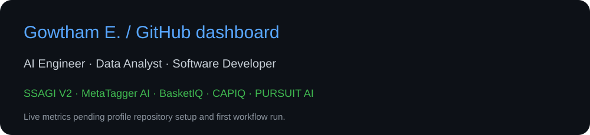

# Hi, I'm Gowtham E.

### AI Engineer · Data Analyst · Software Developer

Building practical applications at the intersection of artificial intelligence, data, and software.

[LinkedIn](https://www.linkedin.com/in/gowtham-e-5153493a6/) · [GitHub Projects](https://github.com/gowthame006-a11y?tab=repositories)

---

## GitHub dashboard

## Technologies used across my projects

**React · TypeScript · Vite · Tailwind CSS · Motoko · Python · FastAPI**

## About me

I'm a B.Tech Artificial Intelligence and Data Science student at Kings Engineering College, Chennai, graduating in 2027. My project interests include multi-agent analysis, content processing, retail analytics, and financial technology.

## Project showcase

| Project | Focus |
| --- | --- |
| **SSAGI V2.0** | Multi-agent analysis and AI governance prototype that explores specialist assessments and orchestrated findings. Source repository is private. |
| [**MetaTagger AI**](https://github.com/gowthame006-a11y/metatagger-ai) | Content categorization, keyword extraction, SEO metadata, and analysis history with React, TypeScript, and Motoko. |
| [**BasketIQ**](https://github.com/gowthame006-a11y/basket-iq) | Market basket analysis project focused on purchase patterns and association rules. |

## Current work

- **CAPIQ** — Final-year project developing a beginner-focused stock market assistant with prediction, risk analysis, portfolio assistance, and explainability.
- **PURSUIT AI 2.0** — Interactive routing and vehicle simulation project with a map frontend and Python FastAPI backend.
- **Personal portfolio** — Presenting my projects and development journey through a professional portfolio website.

These projects are in development; public repository links will be added when available.

## Interests

Multi-agent systems · Applied AI · Data analysis · Full-stack development · FinTech

## Connect

I'm interested in internships, graduate opportunities, and collaboration on AI, data, and software projects.

[Connect with me on LinkedIn](https://www.linkedin.com/in/gowtham-e-5153493a6/)
